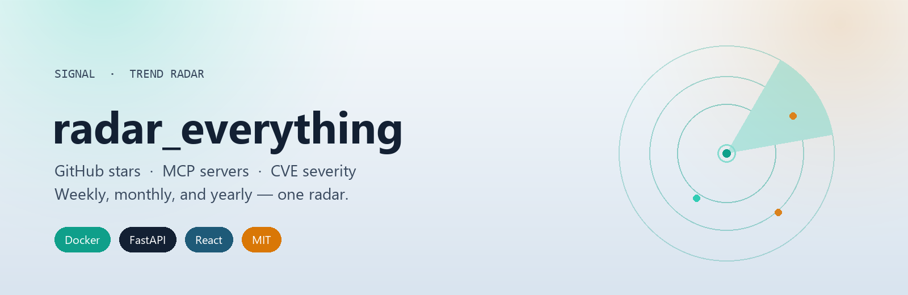
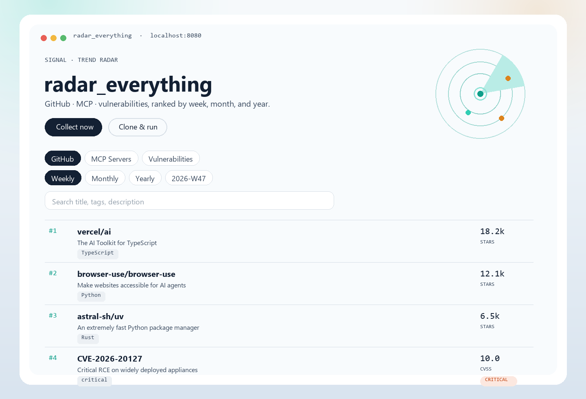

<div align="center">


# radar_everything

**무엇이든 레이더에 올려라.**  
GitHub 스타 · MCP 서버 · 취약점(CVE)을 주간 · 월간 · 연간으로 모으는 확장형 오픈소스 레이더.

**Put anything on the radar.**  
An extensible open-source radar for GitHub stars, MCP servers, and CVE severity — weekly, monthly, and yearly.

[](https://docs.docker.com/compose/)
[](https://www.python.org/)
[](https://react.dev/)
[](https://fastapi.tiangolo.com/)
[](./LICENSE)

<br />

[Live demo](https://theshewaspretty.github.io/radar_everything/app/)
·
[Docs](./docs/MANUAL.md)
·
[Pages setup](./docs/PAGES.md)
·
[English](#english)
·
[한국어](#한국어)
·
[中文](#中文)



</div>

---

## Preview

<div align="center">



<sub>예시 화면은 <code>scripts/render_readme_images.py</code> 를 실행해 생성했습니다. 다시 그리려면 <code>python scripts/render_readme_images.py</code><br />Preview images are generated by that script. Regenerate with the same command.</sub>

</div>

---

## Why this exists

| | |
|---|---|
| **Everything** | GitHub만이 아니라 MCP · 취약점 신호를 같은 화면에서 봅니다. |
| **Radar** | 주 / 월 / 연 타임라인으로 지금 튀는 항목을 스캔합니다. |
| **Extensible** | `BaseCollector` 하나만 추가하면 UI · API · 스케줄러에 붙습니다. |
| **Clone & run** | `docker compose up` 한 줄, 또는 GitHub Pages 데모로 먼저 체험합니다. |

---

## Features

| Source | What you get |
|---|---|
| **GitHub** | 기간 안 공개 저장소를 star 기준으로 랭킹. Search API, 실패 시 Trending fallback. |
| **MCP** | `mcp-server` 토픽과 공식 Registry 메타로 인기 서버를 정렬. |
| **Vulnerabilities** | 보호나라 RSS + NVD CVSS. Critical → Low 필터. |
| **Schedule** | 기동 시 수집, UTC cron, UI의 **지금 수집**, REST API. |
| **Pages demo** | 같은 UI를 정적 사이트로. GitHub/MCP는 브라우저에서 라이브 조회 가능. |

---

## Quick start

```bash
git clone https://github.com/theshewaspretty/radar_everything.git
cd radar_everything
cp .env.example .env
docker compose up --build -d
```

브라우저에서 **http://localhost:8080**

```env
# .env  (권장)
GITHUB_TOKEN=ghp_xxxxxxxxxxxxxxxx
PORT=8080
```

```bash
docker compose logs -f app
docker compose down          # 중지, 데이터 유지
docker compose down -v       # DB까지 삭제
```

토큰 없이도 동작합니다. 비인증 GitHub API는 시간당 약 60회라 실사용에는 토큰을 권장합니다.

### GitHub Pages

Settings → Pages → **Deploy from a branch** → Folder **`/docs`**

| | |
|---|---|
| 소개 | https://theshewaspretty.github.io/radar_everything/ |
| 데모 앱 | https://theshewaspretty.github.io/radar_everything/app/ |

`/site` 폴더는 Pages Source로 선택할 수 없습니다. 사이트 파일은 `docs/` 에 있습니다. 자세한 절차는 [docs/PAGES.md](./docs/PAGES.md).

---

## Docker vs Pages demo

| | Docker full stack | GitHub Pages |
|---|---|---|
| UI | Yes | Yes |
| GitHub / MCP live | Server | Browser → GitHub API |
| KISA / NVD live | Yes | Sample only (CORS) |
| Scheduler · SQLite · REST | Yes | No |
| Best for | 로컬 · 셀프호스트 | 공개 체험 |

---

## How to use the dashboard

1. 소스: **GitHub / MCP / 취약점**
2. 기간: **주간 · 월간 · 연간** (`2026-W47`, `2026-11`, `2026`)
3. 검색, 취약점은 심각도 필터
4. 비어 있으면 **지금 수집** (Pages에서는 **데모 수집**)

GitHub은 “기간 중 star 증가량” 공식 API가 없습니다. 기간 내 생성·활동 저장소의 star 랭킹과 Trending fallback을 사용합니다.

---

## API

Base: `http://localhost:8080` · Swagger: `http://localhost:8080/docs`

| Method | Path | |
|---|---|---|
| `GET` | `/api/health` | 헬스체크 |
| `GET` | `/api/sources` | 소스 목록 |
| `GET` | `/api/periods/{source}/{period_type}` | 기간 키 |
| `GET` | `/api/trends/{source}` | 랭킹 |
| `POST` | `/api/collect?sync=true` | 즉시 수집 |
| `GET` | `/api/runs` | 수집 이력 |
| `GET` | `/api/stats` | 통계 |

```bash
curl -X POST "http://localhost:8080/api/collect?sync=true" \
  -H "Content-Type: application/json" \
  -d "{\"source\":\"github\",\"period_type\":\"weekly\"}"
```

---

## Add a source

1. `backend/app/collectors/my_source.py` 에 `BaseCollector` 구현
2. `registry.py` 에서 `register(MyCollector())`
3. `ENABLED_SOURCES` 에 id 추가

템플릿: [`backend/app/collectors/example_plugin.py`](./backend/app/collectors/example_plugin.py)

---

## Local development

```bash
# backend
cd backend
python -m venv .venv
.\.venv\Scripts\Activate.ps1
pip install -r requirements.txt
$env:COLLECT_ON_STARTUP='false'
uvicorn app.main:app --reload --port 8000
```

```bash
# frontend (API 연동)
cd frontend && npm install && npm run dev
# http://localhost:5173

# Pages와 같은 데모 모드
npm run dev:demo
```

---

## Layout

```text
radar_everything/
├── backend/app/          # FastAPI, collectors, scheduler, SQLite
├── frontend/             # React UI  (demo: src/api/demo.ts)
├── docs/
│   ├── assets/           # README images (generated)
│   ├── index.html        # GitHub Pages landing
│   ├── app/              # Pages demo build
│   ├── MANUAL.md
│   └── PAGES.md
├── scripts/render_readme_images.py
├── docker-compose.yml
└── Dockerfile
```

| Variable | Default | |
|---|---|---|
| `GITHUB_TOKEN` | empty | GitHub API |
| `NVD_API_KEY` | empty | NVD |
| `ENABLED_SOURCES` | `github,mcp,vulnerability` | |
| `COLLECT_ON_STARTUP` | `true` | |
| `COLLECT_CRON_HOURS` | `6,18` | UTC |
| `PORT` | `8080` | |

전체 설명: [docs/MANUAL.md](./docs/MANUAL.md)

---

## License

[MIT](./LICENSE)

<div align="center">

<sub>Images: <code>python scripts/render_readme_images.py</code> · UI type: Segoe UI on the generated previews. App UI uses Sora, Instrument Sans, IBM Plex Mono.</sub>

</div>

---

## English

Track GitHub stars, MCP servers, and vulnerability severity on one timeline. Run the full stack with Docker, or try the UI on [GitHub Pages](https://theshewaspretty.github.io/radar_everything/app/).

### Why

| | |
|---|---|
| **Everything** | GitHub, MCP, and CVE signals share one dashboard. |
| **Radar** | Scan what is moving this week, month, or year. |
| **Extensible** | Implement `BaseCollector` and it shows up in the UI, API, and scheduler. |
| **Clone and run** | `docker compose up`, or open the Pages demo first. |

### Features

| Source | What you get |
|---|---|
| **GitHub** | Public repos ranked by stars inside a date window. Search API, Trending HTML fallback. |
| **MCP** | `mcp-server` topics plus official registry metadata. |
| **Vulnerabilities** | KISA BohoNara RSS and NVD CVSS, filtered from Critical to Low. |
| **Schedule** | Collect on startup, UTC cron, **Collect now**, and a REST API. |
| **Pages demo** | The same UI as a static site. GitHub and MCP can query the GitHub API from the browser. |

### Quick start

```bash
git clone https://github.com/theshewaspretty/radar_everything.git
cd radar_everything
cp .env.example .env
docker compose up --build -d
```

Open **http://localhost:8080**

```env
GITHUB_TOKEN=ghp_xxxxxxxxxxxxxxxx
PORT=8080
```

```bash
docker compose logs -f app
docker compose down          # stop, keep the database
docker compose down -v       # delete the database volume
```

The app runs without a token. Unauthenticated GitHub calls are about 60 per hour, so a token is recommended.

### GitHub Pages

Settings → Pages → **Deploy from a branch** → Folder **`/docs`**.

| | |
|---|---|
| Landing | https://theshewaspretty.github.io/radar_everything/ |
| Demo app | https://theshewaspretty.github.io/radar_everything/app/ |

GitHub Pages cannot use a `/site` folder as the source. Site files live in `docs/`. See [docs/PAGES.md](./docs/PAGES.md).

### Docker vs Pages

| | Docker full stack | GitHub Pages |
|---|---|---|
| UI | Yes | Yes |
| GitHub / MCP live | Server | Browser → GitHub API |
| KISA / NVD live | Yes | Sample only (CORS) |
| Scheduler, SQLite, REST | Yes | No |
| Best for | Local and self-hosted | Public preview |

### Dashboard

1. Pick **GitHub**, **MCP**, or **Vulnerabilities**.
2. Pick **Weekly**, **Monthly**, or **Yearly** (`2026-W47`, `2026-11`, `2026`).
3. Search. On vulnerabilities, filter by severity.
4. If a period is empty, use **Collect now** (on Pages: **Demo collect**).

GitHub has no official API for “stars gained during this week.” Rankings use repos created or active in that window, plus a Trending fallback.

### API

Base `http://localhost:8080` · Swagger `http://localhost:8080/docs`

| Method | Path | |
|---|---|---|
| `GET` | `/api/health` | Health |
| `GET` | `/api/sources` | Sources |
| `GET` | `/api/periods/{source}/{period_type}` | Period keys |
| `GET` | `/api/trends/{source}` | Rankings |
| `POST` | `/api/collect?sync=true` | Collect now |
| `GET` | `/api/runs` | Run history |
| `GET` | `/api/stats` | Stats |

```bash
curl -X POST "http://localhost:8080/api/collect?sync=true" \
  -H "Content-Type: application/json" \
  -d "{\"source\":\"github\",\"period_type\":\"weekly\"}"
```

### Add a source

1. Implement `BaseCollector` in `backend/app/collectors/my_source.py`.
2. Call `register(MyCollector())` in `registry.py`.
3. Add the id to `ENABLED_SOURCES`.

Template: [`backend/app/collectors/example_plugin.py`](./backend/app/collectors/example_plugin.py)

### Local development

```bash
cd backend
python -m venv .venv
# Windows: .\.venv\Scripts\Activate.ps1
# macOS/Linux: source .venv/bin/activate
pip install -r requirements.txt
# PowerShell: $env:COLLECT_ON_STARTUP='false'
uvicorn app.main:app --reload --port 8000
```

```bash
cd frontend
npm install
npm run dev          # http://localhost:5173  (proxies /api)
npm run dev:demo     # same mode as GitHub Pages
```

Operations, environment variables, and troubleshooting: [docs/MANUAL.md](./docs/MANUAL.md)

---

## 한국어

Docker로 전체 스택을 띄우거나, [Pages 데모](https://theshewaspretty.github.io/radar_everything/app/)에서 UI만 먼저 볼 수 있습니다.

```bash
git clone https://github.com/theshewaspretty/radar_everything.git
cd radar_everything
cp .env.example .env
docker compose up --build -d
```

- 화면: http://localhost:8080
- 소스 3종(GitHub, MCP, 취약점)을 주·월·연으로 랭킹
- 새 소스는 `BaseCollector` 플러그인
- Pages는 **Settings → Pages → Folder `/docs`**
- 운영·API·트러블슈팅: [docs/MANUAL.md](./docs/MANUAL.md)

## 中文

用 Docker 跑完整栈，或先打开 [Pages 演示](https://theshewaspretty.github.io/radar_everything/app/)。

```bash
git clone https://github.com/theshewaspretty/radar_everything.git
cd radar_everything
cp .env.example .env
docker compose up --build -d
```

- 打开 http://localhost:8080
- GitHub / MCP / 漏洞，按周、月、年排名
- 通过 `BaseCollector` 增加数据源
- Pages 请选择 **Folder `/docs`**（不能选 `/site`）
- 详细说明见 [docs/MANUAL.md](./docs/MANUAL.md)
